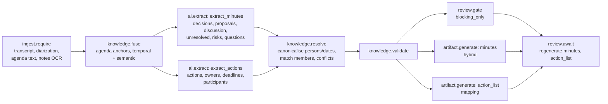

# Meeting Minutes — Workflow

| Field | Value |
|---|---|
| Status | Accepted |
| Spec class | Implementation-ready (DSL Provisional) |
| Version | 1.0.0 |
| Last Updated | 2026-09-28 |
| Owner | Module Platform + AI Engineer |
| Blueprint | BP §3.1, App. A (Meeting Minutes Flow), §12.1 |

## Processing DAG (`meeting-processing`)



Stages: `preparing_sources` → `understanding` → `review` → `drafting`. Full YAML in [workflow-reference](../sdk/workflow-reference.md).

## Speaker Resolution

Diarization labels (S1..Sn) map to participants by: explicit participant list + self-introductions + name mentions + (optional) chair assignment in UI. Low-confidence mappings create `ambiguous_speaker` review items; the hybrid `review.speaker-resolver` component lets users listen to samples per label and assign.

## Additional Artifacts (`meeting-additional-artifact`)

`POST /v1/jobs/{id}/artifacts {artifact_type: executive_summary|follow_up|transcript}` → new run (trigger `additional_artifact`) → `artifact.generate` from current Knowledge (no re-extraction).

## Approval (`minutes-approval`, default)

```yaml
stages:
  - key: owner_review
    mode: all
    approvers: [{ rule: job_creator }]
  - key: manager_approval
    mode: any
    approvers: [{ rule: role, role: manager }]
final_on: all_stages_approved
```

Requirement `configurable` (config `approvalRequired`, default false). Chair can be configured as approver (`rule: user` from job input chair).

## Finalisation Effects

Numbering `MM-{yyyy}-{seq:4}` (org-customisable); Action Items created from `meeting.action` at `final` ([action-items](../../platform/actions/action-items.md)); export PDF/DOCX.
