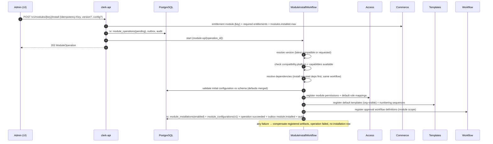

# Module Installation

| Field | Value |
|---|---|
| Status | Accepted |
| Spec class | Implementation-ready |
| Version | 1.0.0 |
| Last Updated | 2026-09-28 |
| Owner | Module Platform |
| Blueprint | BP §4, EPIC-05, G5 ("Four modules install as packages") |

## Installation Lifecycle

## Rules

- Idempotent by operation (and by `Idempotency-Key`); a second install on an existing non-uninstalled installation → `409 MODULE_ALREADY_INSTALLED`.
- Only one in-flight operation per (org, module) (`MODULE_OPERATION_IN_PROGRESS`).
- Registration steps are idempotent upserts keyed by (org, module, version, item key).
- Assignments (teams/projects) optional at install; default = organization-wide.
- Installing never grants permissions beyond manifest `defaultRoles` mapping to system roles; custom roles are untouched.
- Emits `module.installed`; the launcher shows the card immediately for users with `<key>.create`.

## Failure Modes

| Failure | Result |
|---|---|
| Not entitled | 402 before operation starts |
| Incompatible platform/capability missing | Operation failed `MODULE_VERSION_INCOMPATIBLE` |
| Dependency unsatisfiable | Operation failed `MODULE_DEPENDENCY_UNSATISFIED` with details |
| Registration failure (transient) | Retried; persistent → compensation + failed |
