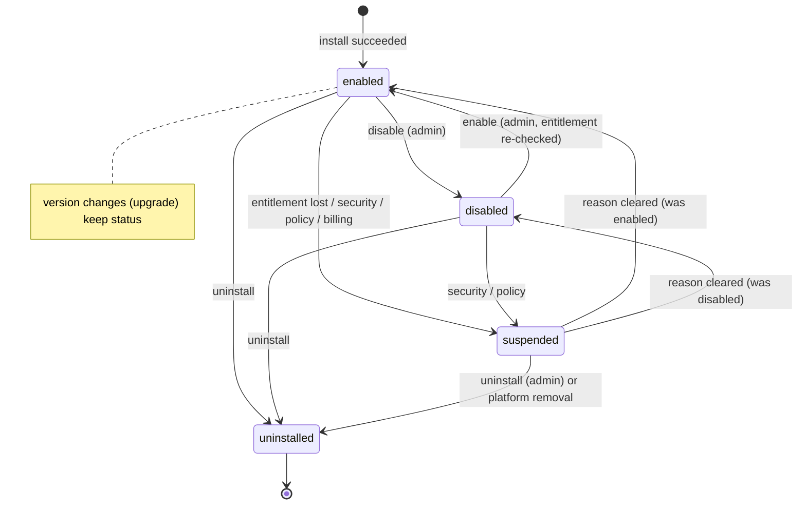

# Module Lifecycle

| Field | Value |
|---|---|
| Status | Accepted |
| Spec class | Implementation-ready |
| Version | 1.0.0 |
| Last Updated | 2026-09-28 |
| Owner | Module Platform |
| Blueprint | BP §4.1 |

## Purpose

**Canonical** mapping of the Blueprint's module states to persisted state. Three layers exist and must not be confused: **Module** (catalog identity), **ModuleVersion** (release), **Installation** (per organization).

## Blueprint States → Model (BP §4.1)

| BP state | Meaning (BP) | Where it lives |
|---|---|---|
| Available | Exists in Store, not installed | Derived: published module with no non-uninstalled installation for the org |
| Installed / Enabled | Installed, active, available for new Jobs | `module_installations.status = enabled` |
| Disabled | New Jobs blocked; historical data readable | `module_installations.status = disabled` |
| Upgrade Available | Newer compatible version exists | Derived: newer `published` version satisfying compatibility and policy |
| Upgrade Required | Current version becoming incompatible/unsupported | Derived: installed version `deprecated`/`blocked` or platform compatibility ending, with `upgrade_required_by` deadline |
| Deprecated | New Job creation may be restricted by policy | `modules.status = deprecated` or `module_versions.status = deprecated` |
| Suspended | Temporarily disabled for security, billing or policy | `module_installations.status = suspended` (+ reason) |
| Uninstalled | Installation logically removed; historical artifacts remain per retention | `module_installations.status = uninstalled` |

## Installation State Machine

A reinstall after uninstall creates a **new** installation row (history preserved).

## ModuleVersion States

```mermaid
stateDiagram-v2
  [*] --> draft: package uploaded
  draft --> published: validation + review + evaluation gates passed
  draft --> [*]: discarded
  published --> deprecated: newer version recommended
  published --> yanked: defect; no new installs/upgrades
  deprecated --> yanked
  published --> blocked: security issue; running jobs stopped, installs suspended
  deprecated --> blocked
  yanked --> blocked
```

## Effects Matrix

| Installation state | New jobs | Existing jobs in flight | Read historical artifacts | Edit/approve existing artifacts | Configure |
|---|---|---|---|---|---|
| enabled | ✓ | continue | ✓ | ✓ | ✓ |
| disabled | ✗ `MODULE_DISABLED` | continue to completion | ✓ | ✓ (policy may restrict) | ✓ |
| suspended | ✗ `MODULE_SUSPENDED` | security: cancelled; billing/policy: continue | ✓ (security: may be restricted) | read-only | ✗ |
| uninstalled | ✗ | cancelled at uninstall | ✓ per retention and authorization | read-only | ✗ |

**Disable is not Uninstall.** See [module-disable-uninstall](module-disable-uninstall.md).
