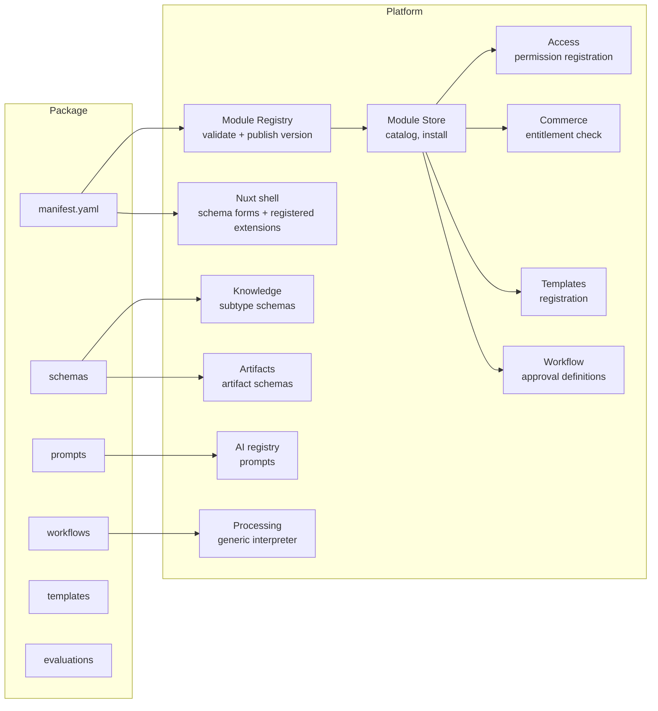

# Module Platform

| Field | Value |
|---|---|
| Status | Accepted |
| Spec class | Implementation-ready |
| Version | 1.0.0 |
| Last Updated | 2026-09-28 |
| Owner | Module Platform |
| Blueprint | BP §1.1 (Module-first), §4, §4.2, §23, [PDR-001](../governance/pdr/PDR-001-module-first-product.md), [ADR-008](../governance/adr/ADR-008-declarative-first-modules.md) |

## Definition

A **Module** is a package defining behaviour, schemas, workflows, prompts, templates, artifacts, evaluations and translations for a use case (BP §30.1). Modules live **on** the platform; the platform never depends on a module.

## Package Structure (BP §4)

```text
<module-package>/
├── manifest.yaml          # the contract (module-manifest.schema.json)
├── schemas/               # configuration, job input, knowledge attributes, artifacts, AI output
├── prompts/               # prompt templates + metadata (registered as PromptVersions)
├── workflows/             # processing and approval definitions (declarative)
├── artifacts/             # artifact generation mappings
├── templates/             # default render templates
├── evaluations/           # suite definitions, dataset references, scorers config
├── translations/          # UI strings (en, fa, …)
├── assets/                # icons
└── runtime/               # ONLY when native logic is necessary (official modules)
```

## How a Module Plugs In



## Runtime Types (BP §4.2)

| Type | Policy | v1 |
|---|---|---|
| Declarative | Manifest + Schema + Workflow + Prompt + Template; preferred | ✓ (all launch modules) |
| Native | Official handler inside Clerk code; only trusted/official modules | ✓ (only if required, per step) |
| Remote | External execution via API contract, sandboxed permissions, no DB access | Future (M2) |

## Invariants

- Adding a module = publishing a package version. No Core code change (verified by the Hello Module, [sprint-1](../execution/sprint-1.md)).
- Module keys and permission/entitlement namespaces are unique and immutable.
- Module packages are immutable per version and integrity-checked (SHA-256, signature for third parties later).
- Modules never access the database, object storage, providers or network directly; only through platform step types and facades.

## Related

[module-runtime-contract](module-runtime-contract.md), [module-lifecycle](module-lifecycle.md), [module-store](module-store.md), [marketplace-architecture](../marketplace/marketplace-architecture.md)
