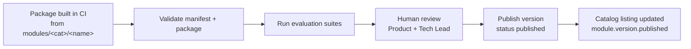

# Module Registry

| Field | Value |
|---|---|
| Status | Accepted |
| Spec class | Implementation-ready |
| Version | 1.0.0 |
| Last Updated | 2026-09-28 |
| Owner | Module Platform |
| Blueprint | BP §0.1, §4, EPIC-04, App. F (module.yaml schema + validator + Hello Module) |

## Responsibilities

- Store modules (`modules`), versions (`module_versions`), dependencies, packages (platform bucket).
- Validate manifests and packages ([module-validation](module-validation.md)).
- Publish versions after gates; register prompts, schemas, templates and workflow definitions **as platform data** referenced by version.
- Resolve modules for jobs: `ResolveForJob(tc, module_key) → PinnedModule{version, manifest, workflow definitions, schemas}`.

## Publication Pipeline (v1: Clerk Official only)

## Caching

Published manifests and schemas are immutable → cached aggressively (in-process + Redis) keyed by version ID.

## Admin Surface

Platform-admin CLI/API (not tenant-facing) to upload/publish/deprecate/yank/block versions; all actions audited.
