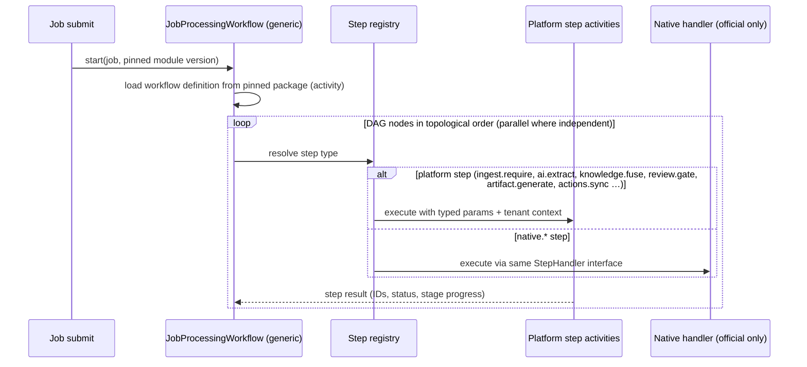

# Module Runtime Contract

| Field | Value |
|---|---|
| Status | Accepted |
| Spec class | Implementation-ready (workflow DSL Provisional, [OD-018](../governance/open-decisions.md#od-018)) |
| Version | 1.0.0 (module runtime contract `platformApi` 1.0.0) |
| Last Updated | 2026-09-28 |
| Owner | Module Platform + Processing |
| Blueprint | BP §4, §4.2, §8, §23 |

## Purpose

The formal contract between a Module and the Platform. A module **declares**; the platform **executes**.

## What a Module Declares

| Declaration | Manifest section | Consumed by |
|---|---|---|
| Identity, version, publisher, category | `module` | Registry, Store |
| Runtime type | `runtime` | Processing (interpreter vs native handlers vs remote gateway) |
| Accepted inputs | `inputs.slots`, `limits`, `readiness`, `autoSubmit` | Jobs, Sources, frontend capture |
| Required platform capabilities | `capabilities` | Registry (installability check) |
| Configuration schema | `configuration` | Module config UI and validation |
| Job input schema | `jobInput` | Job creation form, validation |
| Knowledge schema | `knowledge.entityTypes`, `relationTypes` | Knowledge validation, review thresholds |
| Artifact schemas | `artifacts[]` | Artifact validation, editor, renderers |
| Workflow definitions | `workflows.processing`, `workflows.approval` | Processing interpreter; Workflow context |
| Permissions | `permissions` | Access (registration + default role mapping) |
| Entitlements | `entitlements` | Commerce (install/use checks), usage previews |
| Prompt profiles / AI capability profiles | `ai.tasks` | AI Gateway |
| Evaluation profiles | `evaluation.suites` | Evaluation runner, release gates |
| Dependencies, compatibility | `dependencies`, `compatibility` | Registry, installer |
| UI mode | `ui` | Nuxt shell |
| Telemetry | `telemetry` | Observability |
| Review policy | `review` | Knowledge/confidence banding |

## Platform Capabilities (v1 catalogue)

Capabilities a module may require (installation fails if missing): `source.transcription`, `source.diarization`, `source.ocr`, `source.handwriting_ocr`, `source.layout`, `source.document_parse`, `source.slide_parse`, `source.vision`, `source.video_frames`, `ai.structured_extraction`, `ai.summarization`, `ai.generation`, `ai.vision_analysis`, `knowledge.fusion`, `knowledge.retrieval`, `knowledge.cross_job_links`, `artifact.export.pdf`, `artifact.export.docx`, `workflow.approval`, `template.numbering`, `actions.tracking`, `pwa.offline_capture`.

## Execution Model



### StepHandler Interface (native and platform steps)

```go
type StepHandler interface {
    Type() string // "ai.extract", "native.meeting.speaker-heuristics"
    Validate(params json.RawMessage, manifest Manifest) error         // at module publication
    Execute(ctx context.Context, sc StepContext) (StepResult, error) // in an activity
}
type StepContext struct {
    Tenant    tenant.Context
    Job       JobView            // read-only
    Run       RunRef
    Params    json.RawMessage
    Platform  PlatformFacades    // Sources, Knowledge, AI Gateway, Artifacts — scoped to this job
}
```

Native handlers receive the same scoped facades; they cannot open DB connections, call providers directly, or access other jobs/tenants.

## Remote Runtime (reserved)

Remote steps (`remote.*`) are executed by the Remote Module Gateway: signed request with scoped job data per `runtime.remote.dataScopes`, strict timeouts, response validated against declared schemas, no direct DB access ([remote-modules](../marketplace/remote-modules.md)). Not executable in v1.

## Versioning

The module runtime contract has its own SemVer (`platformApi`). Manifests declare `compatibility.platform` ranges ([compatibility-policy](compatibility-policy.md)).
