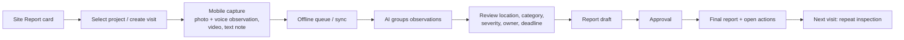

# Site Report — Product Specification

| Field | Value |
|---|---|
| Status | Accepted |
| Spec class | Implementation-ready |
| Version | 1.0.0 |
| Last Updated | 2026-09-28 |
| Owner | Product |
| Blueprint | BP §3.2, App. A |

## Goal (BP §3.2)

Document a construction or field visit with minimal friction on mobile. The user captures photos, video, voice or text; Clerk produces Observations, location, category, severity, owner, corrective action, deadline and evidence. Repeat Inspection is in the domain model from day one.

## Users

Construction engineers, site inspectors, supervisors (members); project managers and consultants (approvers); clients/external consultants (guests, view).

## Capabilities

| Capability | v1 |
|---|---|
| Project context (visit belongs to a project) | ✓ (required by default for repeat inspection) |
| Mobile-first capture (camera, voice, video, text) | ✓ |
| Offline capture + queue + sync | ✓ |
| Link voice description to the right photo/observation | ✓ (capture grouping + AI fusion + manual linking) |
| Observation attributes: location, category, severity, issue, corrective action, responsible party, deadline, evidence | ✓ |
| Lifecycle Open / Resolved / Overdue | ✓ (via Action Items + issue status) |
| Repeat Inspection with before/after evidence comparison | ✓ |
| Independent, trackable Action Items | ✓ |
| Approval workflow (Engineer → PM → Consultant) | ✓ (configurable) |
| Formal Site Report template + numbering | ✓ |
| Drawings/specifications as reference | ✓ (context only) |
| Plan/drawing pin placement of observations | Future |
| BIM integration | Future |

## Visit Flow (App. A)

## Capture UX Principles

One-handed operation; "observation" as the capture unit (photo(s) + optional voice + optional note grouped by a tap-to-start/stop observation session or by time window); large controls; works in sunlight (contrast); minimal typing; clear Local/Pending/Uploading/Synced status (BP §21).

## Non-Goals

Scheduling, cost tracking, BIM, full QA/QC management systems (NCR/RFI are future modules).
