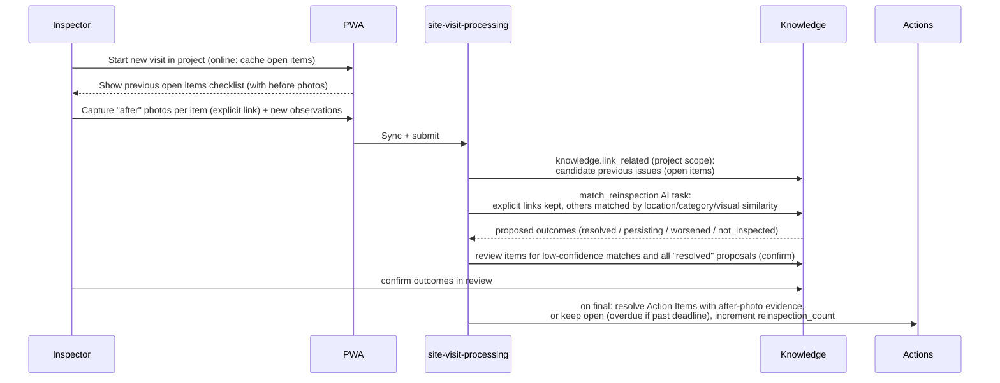

# Site Report — Repeat Inspection

| Field | Value |
|---|---|
| Status | Accepted |
| Spec class | Implementation-ready |
| Version | 1.0.0 |
| Last Updated | 2026-09-28 |
| Owner | Product + AI Engineer |
| Blueprint | BP §3.2 ("Repeat Inspection must be represented in the domain model from day one"; "before/after evidence comparison"), App. D ("Open item from previous visit can become Resolved/Overdue and receive new Evidence") |

## Domain Model

- An **issue** (`site.issue`) is created in the visit where first observed and has a corrective Action Item after finalisation.
- In later visits of the **same project**, new observations may `REINSPECTS` an existing issue (cross-job relation, project scope).
- The issue's lifecycle across visits is tracked through the Action Item (open / in_progress / resolved; overdue derived) and issue `status` + `reinspection_count`.

## Flow

## Rules

- **Resolved requires evidence:** a corrective action becomes `resolved` via repeat inspection only with at least one confirmed "after" evidence link.
- Explicit user links (checklist "after" capture) override AI matching.
- Items not inspected in this visit remain open; the report lists them as "not inspected".
- Before/after comparison: artifact section renders previous photos (from the earlier Source, if not deleted by retention) and current photos side by side.
- If the earlier Source was deleted by retention, the comparison shows metadata with "original photo no longer available".
