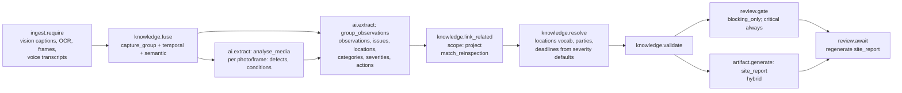

# Site Report — Workflow

| Field | Value |
|---|---|
| Status | Accepted |
| Spec class | Implementation-ready (DSL Provisional) |
| Version | 1.0.0 |
| Last Updated | 2026-09-28 |
| Owner | Module Platform + AI Engineer |
| Blueprint | BP §3.2, App. A (Site Report Flow) |

## Processing DAG (`site-visit-processing`)



Stages: `syncing_captures` → `analysing_media` → `grouping_observations` → `checking_previous_visit` → `review` → `drafting`.

## Approval (`site-report-approval`, default; configurable)

```yaml
stages:
  - key: engineer_signoff
    mode: all
    approvers: [{ rule: job_creator }]
  - key: pm_review
    mode: quorum
    quorum: 1
    approvers: [{ rule: project_role, role: project_manager }]
    due: P2D
  - key: consultant_approval
    mode: any
    approvers: [{ rule: project_role, role: consultant }]
final_on: all_stages_approved
separation_of_duties: true
```

Default requirement: `approvalRequired: true` (configurable).

## Finalisation Effects

- Numbering `SR-{project}-{yyyy}-{seq:4}`.
- Action Items created/updated from `site.corrective_action` (trigger `final`): new issues → new Action Items; repeat-inspection outcomes → resolve existing Action Items (with after-photo evidence) or keep open (overdue flag if past deadline).
- `open_items_list` can be generated on demand at project level.
