# CI/CD

| Field | Value |
|---|---|
| Status | Accepted |
| Spec class | Implementation-ready (CI platform choice is implementation detail) |
| Version | 1.0.0 |
| Last Updated | 2026-09-28 |
| Owner | DevOps + Tech Lead |
| Blueprint | BP §18.1, §14.2, §29.2 |

## Pipeline (BP §18.1)

```mermaid
flowchart LR
  PR[PR] --> LF[lint / format]
  LF --> GUT[Go unit tests]
  LF --> TST[TypeScript tests]
  GUT & TST --> SCH[schema / API compatibility<br/>OpenAPI validate + diff,<br/>JSON Schemas, event schemas]
  SCH --> SEC[security scans<br/>SAST, secrets, deps, IaC]
  SEC --> MIG[DB migration test<br/>fresh + upgrade + lint]
  MIG --> MOD[module validation<br/>manifests L1–L7]
  MOD --> EVS[AI eval smoke<br/>affected modules]
  EVS --> IMG[build signed images<br/>+ SBOM]
  IMG --> STG[staging deploy]
  STG --> E2E[integration / E2E<br/>+ smoke]
  E2E --> GATE[manual / automated gate]
  GATE --> CAN[production canary]
  CAN --> MON[monitor / rollback]
```

## Required Checks

| Check | Blocking | Notes |
|---|---|---|
| Formatting (gofmt/goimports, prettier) | Yes | |
| Lint (golangci-lint, eslint, markdownlint for docs) | Yes | |
| Static analysis (go vet, staticcheck, TS strict) | Yes | |
| Architecture boundaries (import + table-ownership lint) | Yes | [dependency-rules](../architecture/dependency-rules.md) |
| Unit tests (Go, TS) | Yes | Coverage reported, not gated by % |
| Integration tests (Testcontainers: PostgreSQL, Redis, MinIO, Temporal) | Yes | |
| Contract tests (OpenAPI vs server, event schemas, manifests) | Yes | |
| DB migration validation | Yes | Fresh apply, upgrade from previous release schema, destructive-change lint |
| OpenAPI validation + breaking-change diff on `/v1` | Yes | |
| JSON Schema compilation + examples validation | Yes | |
| Mermaid diagram parsing (docs) | Yes (docs PRs) | |
| Link check (docs) | Yes (docs PRs) | |
| Security scan: SAST, secret scan | Yes | |
| Dependency + container + IaC scan | Yes (Critical/High) | |
| Tenant-isolation tests (RLS, BOLA) | Yes | BP App. F |
| AI eval smoke (affected modules) | Yes when AI assets change | [regression-gates](../ai/evaluation/regression-gates.md) |
| Container build + signing + SBOM | Yes (main) | |
| Staging deploy + smoke tests | Yes (release) | |
| E2E suite | Yes (release) | |
| Rollback readiness check | Yes (release) | Previous image available; migrations expand-only or reviewed |

## CD

Trunk-based; main is always deployable; releases promoted from staging to production via canary (for example 10% traffic for API; worker pools rolled gradually) with automated SLO-based rollback triggers ([deployment](deployment.md), [rollback](rollback.md)).
