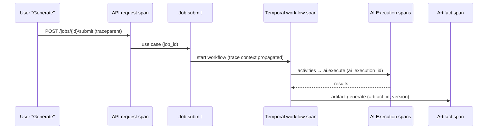

# Observability

| Field | Value |
|---|---|
| Status | Accepted |
| Spec class | Implementation-ready (backend Open) |
| Version | 1.0.0 |
| Last Updated | 2026-09-28 |
| Owner | SRE + Tech Lead |
| Blueprint | BP §17, [ADR-014](../governance/adr/ADR-014-opentelemetry.md) |

## Correlatable Identifiers (BP §17)

| Identifier | Purpose | Propagation |
|---|---|---|
| `request_id` | Every API request | Response header, logs, error body |
| `correlation_id` | Full end-to-end business operation | Header → Temporal memo/context → events → AI executions |
| `job_id` | Job lifecycle | Span attribute, logs |
| `workflow_id` / `run_id` | Temporal execution | Temporal interceptors |
| `ai_execution_id` | Every model call or fallback attempt | Span attribute |
| `artifact_id` / version | Final output and provenance | Span attribute |
| `organization_id` | Tenant | Attribute where safe (internal backends only) |

## Trace Example

## Pillars

[logging](logging.md) · [metrics](metrics.md) · [tracing](tracing.md) · [opentelemetry](opentelemetry.md) · [sli-slo](sli-slo.md) · [alerting](alerting.md)

## Sensitive Data

No customer content, secrets, tokens or full prompts in any telemetry ([logging](logging.md)).
