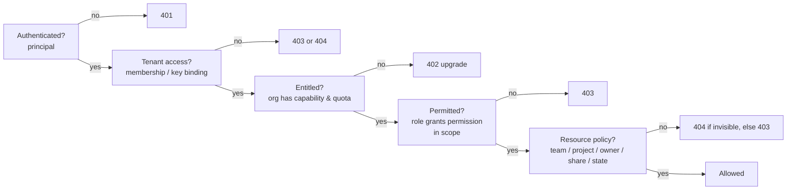

# Authorization Model

| Field | Value |
|---|---|
| Status | Accepted |
| Spec class | Implementation-ready |
| Version | 1.0.0 |
| Last Updated | 2026-09-28 |
| Owner | Access domain + Security |
| Blueprint | BP §1.1 (Entitlement-aware), §13, §14.2, App. C |

## Purpose

Canonical definition of how Clerk decides whether an action is allowed, and of the Permission vs Entitlement distinction ([BDR-003](../../governance/bdr/BDR-003-module-entitlements.md)).

## Decision Pipeline



BP §13 states the order as *Authenticated → Entitled → Permitted → Resource Policy → Allowed*; this model makes the implicit **tenant access** step explicit (a refinement, not a change).

## Definitions

| Concept | Question answered | Source of truth | Owner |
|---|---|---|---|
| **Entitlement** | Has this *organization* the right to this capability (and remaining quota)? | Plan version + add-ons + org overrides ([entitlement-model](../entitlements/entitlement-model.md)) | commerce |
| **Permission** | May this *user/key* perform this operation type? | Roles → permissions ([rbac](rbac.md)) | access |
| **Resource policy** | May this principal act on *this specific resource* now? | Scope, ownership, grants, resource state ([resource-policies](resource-policies.md)) | access + owning context |

Example (BP brief): *Permission* — user may export DOCX (`artifacts.export`). *Entitlement* — organization's plan includes DOCX export (`export.docx`). Both are required.

## Interface

```go
// internal/platform/authz (illustrative)
type Check struct {
    Permission   string          // e.g. "artifacts.export"
    Entitlements []string        // e.g. ["export.docx"]
    Resource     *ResourceRef    // type, id, org, owner, team_id, project_id, state
    Meter        *MeterReservation // optional quota reservation
}
type Guard interface {
    Authorize(ctx context.Context, tc tenant.Context, c Check) (Decision, error)
}
```

`Decision` carries `allowed`, `reason_code` (maps to API error codes) and `obligations` (for example "hide transcript field"). Denials of security-relevant operations are audited (`outcome=denied`).

## Scopes

Role assignments have a scope: `organization`, `team:{id}`, `project:{id}`. A permission granted at organization scope applies to all resources in the org (subject to resource policy); at team/project scope only to resources in that team/project. Scope evaluation rules: [resource-policies](resource-policies.md).

## Module Permissions

Modules register namespaced permissions at installation (`<module-key>.<action>`) with default role mappings from the manifest. Operations on module-owned resources check **both** a platform permission and the module permission, for example Job creation requires `jobs.create` **and** `business.meeting-minutes.create`; approval of a Site Report requires `artifacts.approve` **and** `construction.site-report.approve`.

## Caching

Effective permission sets per (membership, scope) and entitlement sets per org are cached in Redis with event-driven invalidation (`access.*`, `entitlement.changed`, `module.*`) and a 5-minute TTL ([redis-usage](../../data/redis-usage.md)). Security-critical denials are never served from a stale *allow*: on role removal the cache key version is bumped synchronously in the same transaction.

## Evolution to ABAC

The `Check.Resource` attributes and `Decision.obligations` allow attribute-based conditions (time, data classification, IP range, device posture) to be added to policies later without changing call sites. ABAC authoring is Future ([v1-scope](../../product/v1-scope.md)).

## Testing

- Unit: evaluator truth tables per role × permission × scope.
- Matrix: generated tests from [permission-matrix](permission-matrix.md) × OpenAPI annotations.
- BOLA and cross-tenant tests ([security-testing](../../testing/security-testing.md)).

## Related Documents

[rbac](rbac.md), [permission-namespaces](permission-namespaces.md), [default-roles](default-roles.md), [custom-roles](custom-roles.md), [feature-gates](../entitlements/feature-gates.md), [api/authorization](../../api/authorization.md)
