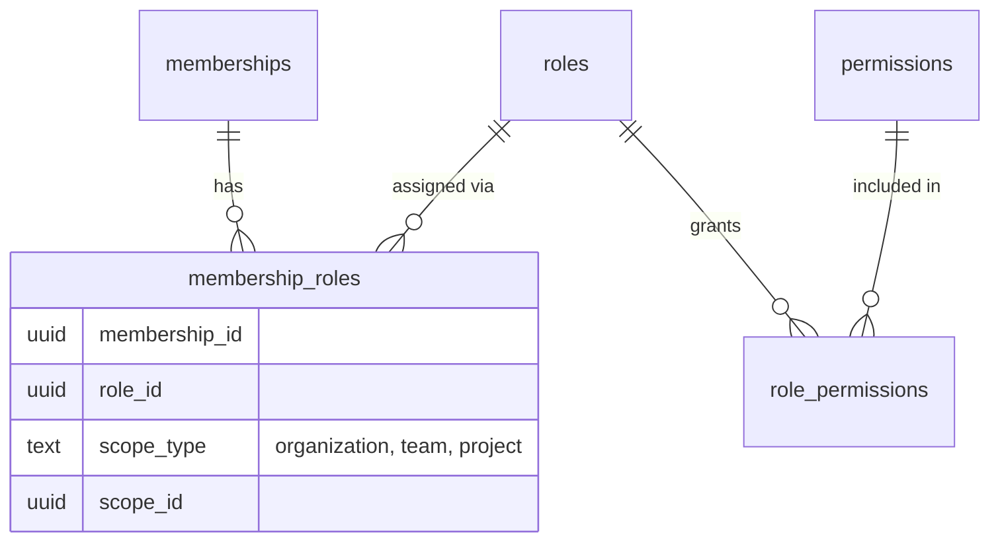

# Role-Based Access Control

| Field | Value |
|---|---|
| Status | Accepted |
| Spec class | Implementation-ready |
| Version | 1.0.0 |
| Last Updated | 2026-09-28 |
| Owner | Access domain |
| Blueprint | BP §13, App. C |

## Model

- **Permission:** stable namespaced key ([permission-namespaces](permission-namespaces.md)).
- **Role:** named set of permissions. System roles (`organization_id NULL`, immutable): `owner`, `admin`, `manager`, `member`, `viewer`, `guest` ([default-roles](default-roles.md)). Custom roles per organization ([custom-roles](custom-roles.md)).
- **Assignment:** membership × role × scope. A membership may hold several assignments; effective permissions = union across assignments applicable to the resource's scope.

## Rules

1. RBAC is only the first layer; resource policy is always evaluated after it (BP §13).
2. Permissions are never checked by role name in code; code checks permission keys.
3. Owner holds all platform permissions and cannot be removed if last Owner (`ORG_LAST_OWNER`).
4. Privilege-changing operations (role changes, ownership transfer) require an MFA-verified session and are audited.
5. A user cannot grant permissions they do not themselves hold (no privilege escalation via custom roles).
6. Module permissions added by installation are assigned to system roles per manifest `defaultRoles`; organizations may adjust custom roles afterwards. On uninstall, module permissions are deactivated (not deleted) so historical audit remains interpretable.

## Related Documents

[authorization-model](authorization-model.md), [permission-matrix](permission-matrix.md)
