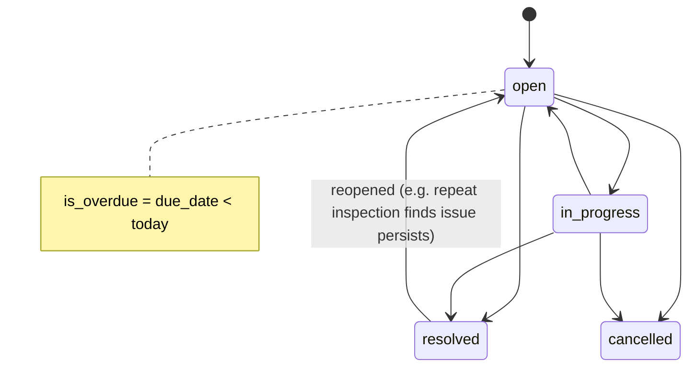

# Action Items

| Field | Value |
|---|---|
| Status | Accepted |
| Spec class | Implementation-ready |
| Version | 1.0.0 |
| Last Updated | 2026-09-28 |
| Owner | Actions domain |
| Blueprint | BP §3.1, §3.2 ("Independent, trackable Action Items"; Open/Resolved/Overdue), §7 (Actions), App. A, App. B |

## Purpose

Trackable commitments (owner, deadline, status) that outlive the Artifact that produced them. Sources: meeting actions, site corrective actions, handwriting tasks, or manual creation.

## Model

| Field | Notes |
|---|---|
| `title`, `description` | From Knowledge or user |
| `owner_membership_id` / `owner_text` | Resolved member, or unresolved text (for example an external contractor) |
| `due_date`, `due_text_original` | Canonical date + original expression ([OD-026](../../governance/open-decisions.md#od-026)) |
| `status` | `open`, `in_progress`, `resolved`, `cancelled` |
| `is_overdue` | Derived: `status ∈ {open, in_progress}` and `due_date < today` in org timezone; maintained by a daily sweep and on update |
| `severity`, `category`, `location` | Optional (Site Report) |
| links | `job_id`, `artifact_id`, `knowledge_entity_id`, `project_id` |
| `origin` | `ai`, `human`, `system` |

BP §3.2 names the lifecycle **Open / Resolved / Overdue**. "Overdue" is modelled as a derived flag on open items rather than a separate status so that an overdue item can still move to `resolved` directly and reporting can distinguish "resolved late".

## State Machine

## Creation from Knowledge

Module manifests declare `artifacts[].createsActionItems { fromEntityTypes, trigger }` (for example on `final`). The Actions context creates one Action Item per qualifying Knowledge entity, idempotently keyed by `knowledge_entity_id`. Subsequent Knowledge corrections update linked open Action Items; removed entities mark Actions `orphaned` (flag) for user decision.

## Resolution with Evidence

Resolving may attach new Sources (for example "after" photo) as resolution evidence (`resolution_source_ids`), recorded in `action_item_history`. Site Report repeat inspection uses this ([repeat-inspection](../../modules/site-report/repeat-inspection.md)).

## Boundaries

No sub-tasks, dependencies, boards or time tracking ([non-goals](../../product/non-goals.md)). Future: webhooks/integrations to task tools.

## Events

`action.created`, `action.updated`, `action.overdue` (once per item per due date), `action.resolved`.
