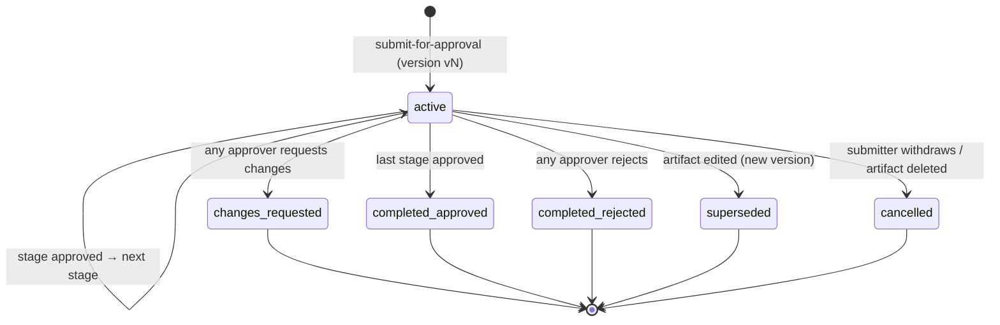

# Approval

| Field | Value |
|---|---|
| Status | Accepted |
| Spec class | Implementation-ready |
| Version | 1.0.0 |
| Last Updated | 2026-09-28 |
| Owner | Workflow domain |
| Blueprint | BP §3.2 (Approval Flow), §12 ("Approval: Configurable workflow; Final state only after required conditions are met"), App. A, App. B |

## Purpose

Generic, configurable approval of Artifact versions. Architecture: [workflow-architecture](../../architecture/workflow-architecture.md). Artifact status effects: [approval-lifecycle](../../artifacts/approval-lifecycle.md).

## Definition Format (workflow version)

```yaml
key: site-report-approval
subject_type: artifact
separation_of_duties: true        # submitter cannot approve own submission
on_edit_during_review: lock       # default; 'supersede' lets an edit supersede the instance (artifact → draft)
stages:
  - key: engineer_signoff
    mode: all                     # all | any | quorum
    approvers: [{ rule: job_creator }]
  - key: pm_review
    mode: quorum
    quorum: 1
    approvers: [{ rule: project_role, role: project_manager }]
    due: P2D
    escalation: { after: P3D, to: { rule: role, role: admin } }
  - key: consultant_approval
    mode: any
    approvers: [{ rule: role, role: manager, scope: project }, { rule: user, id: "<membership-id>" }]
final_on: all_stages_approved
```

Approver rules: `job_creator`, `user`, `role` (with optional scope), `team_lead`, `project_role`. Stages execute sequentially; within a stage `mode` controls completion.

## Instance Lifecycle



## Rules

- Approval targets one ArtifactVersion; decisions carry `artifact_version_id` and are rejected if it is not the instance subject (`WORKFLOW_VERSION_MISMATCH`).
- Decisions are append-only, audited, and may include signature metadata (display name, role title, timestamp; optional drawn signature image referenced from Brand Kit/user profile).
- When a module's approval requirement is `configurable`, the organization decides (module configuration `approvalRequired`). `required` means Final is impossible without an approved instance.
- Entitlement `workflow.approval` gates approval workflows; `limited` = single-stage only (proposed, [plan-entitlements](../entitlements/plan-entitlements.md)).
- Due dates and escalation run on Temporal timers; reminders via notifications.
- Approval logic is never hard-coded per module; modules only ship default definitions.

## Events and Audit

`approval.requested`, `approval.decided`, `workflow.instance.completed`, `artifact.approved`, `artifact.finalized`. Audit: submit, each decision, withdrawal, escalation, override by admin (if ever allowed — not in v1).
