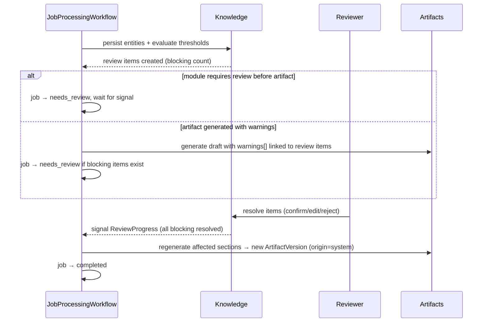

# Review (Human-in-the-Loop)

| Field | Value |
|---|---|
| Status | Accepted |
| Spec class | Implementation-ready |
| Version | 1.0.0 |
| Last Updated | 2026-09-28 |
| Owner | Knowledge domain (review items) + Frontend (Review Queue) |
| Blueprint | BP §1.1 (Human-in-the-loop), §10.2, §16.2, App. A (Review Queue), App. D |

## Purpose

Defines Review Items: how uncertain or high-risk AI output is routed to people, and how resolution feeds back into Knowledge and Artifacts. Correction states are canonical in [human-correction](../../knowledge/human-correction.md); confidence bands in [confidence-model](../../knowledge/confidence-model.md).

## When a Review Item Is Created

| Reason code | Trigger |
|---|---|
| `low_confidence` | Confidence below the entity type's threshold (module config) |
| `missing_evidence` | Evidence-required field lacks valid evidence |
| `conflicting_sources` | Fusion found contradicting evidence (for example agenda deadline ≠ spoken deadline) |
| `ambiguous_speaker` | Speaker/owner attribution ambiguous (BP App. D: "Ambiguous speaker creates a Review Item rather than a guess") |
| `unreadable` | Handwriting/OCR span below legibility threshold (BP App. D "No silent invention") |
| `schema_gap` | Required artifact field could not be filled |
| `policy` | Module/org policy requires review regardless (for example `alwaysReview`) |

Severity: `blocking` (prevents finalisation; `blocksFinalization: true`), `warning`, `info`.

## Resolution Actions

| Action | Effect on target | Review state |
|---|---|---|
| Confirm | Value unchanged | `human_confirmed` |
| Edit | New value validated against schema; new Knowledge revision; evidence re-linked or user-attested | `human_modified` |
| Reject | Item excluded from artifacts | `rejected` |
| Defer | Remains open, assigned to someone else | `unresolved` |

Every resolution is audited and emits `knowledge.item.*` events used by the evaluation candidate pipeline ([correction-data](../../ai/training/correction-data.md)).

## Flow

## Review Queue

Aggregated across jobs for a user: items assigned to them or in their scope, ordered by severity and job age. Keyboard-first UX with evidence side-by-side ([review-queue](../../frontend/review-queue.md)).

## Relation to Approval

Review resolves item-level uncertainty. Approval is document-level sign-off ([approval](approval.md)). An Artifact with open blocking review items cannot be submitted for approval (`ARTIFACT_UNRESOLVED_REVIEW_ITEMS`).
