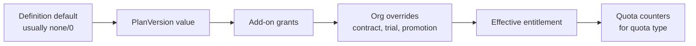

# Entitlement Model

| Field | Value |
|---|---|
| Status | Accepted |
| Spec class | Implementation-ready |
| Version | 1.0.0 |
| Last Updated | 2026-09-28 |
| Owner | Commerce domain |
| Blueprint | BP §1.1, §5, §13, §22, App. C, [BDR-003](../../governance/bdr/BDR-003-module-entitlements.md) |

## Purpose

Canonical definition of entitlements: what an **organization** may use, how much, and why.

## Concepts

| Concept | Table | Description |
|---|---|---|
| EntitlementDefinition | `entitlement_definitions` | Platform catalogue of keys with value type (`boolean`, `limit`, `quota`, `enum`) and unit |
| Plan / PlanVersion | `plans`, `plan_versions` | Commercial offering; immutable versioned bundle |
| PlanEntitlement | `plan_entitlements` | Value of each entitlement in a PlanVersion |
| Subscription | `subscriptions` | Org → PlanVersion, seats, period |
| Add-on | `subscription_addons` | Packs/modules purchased on top (for example `pack.construction`) |
| OrganizationEntitlement | `organization_entitlements` | Overrides: add-on grants, contract terms, trials, promotions, support overrides; time-bounded |

## Resolution

Merge rules by type:
- `boolean`: any grant true → true, unless an override explicitly sets false (for example suspension).
- `limit`: maximum across sources unless an override sets an explicit value with `mode: set`.
- `quota`: sum of plan included amount + add-on amounts + override amounts for the period.
- `enum` (`none < limited < full`): highest level.

The effective set is computed per organization, cached, and invalidated on `subscription.changed` / `entitlement.changed`.

## Entitlement Key Catalogue (v1)

| Key | Type | Unit | Notes |
|---|---|---|---|
| `module.<module-key>` | enum (`none`, `limited`, `full`) | — | Required to install/use module. `limited` = quota-limited use (BP App. C "Four Launch Modules: Personal — Limited") |
| `pack.construction` | boolean | — | Add-on; grants `module.construction.site-report` (+ future pack modules) |
| `seats.max` | limit | seats | |
| `modules.installed.max` | limit | count | |
| `jobs.concurrent` | limit | jobs | Concurrent processing jobs |
| `ai.credits.monthly` | quota | AI credits | Customer-facing unit ([ai-credit-model](../../billing/ai-credit-model.md)) |
| `processing.minutes.monthly` | quota | minutes | Audio/video processing |
| `pages.monthly` | quota | pages | OCR/document pages |
| `storage.bytes` | limit | bytes | |
| `upload.max_bytes` | limit | bytes | Per file |
| `upload.max_duration_seconds` | limit | seconds | Per media file |
| `export.pdf` | boolean | — | |
| `export.docx` | boolean | — | |
| `template.custom` | boolean | — | Custom brand/template (BP App. C) |
| `roles.custom` | enum | — | none/limited/full |
| `workflow.approval` | enum | — | Approval workflows |
| `audit.log` | enum | — | limited = shorter lookback |
| `audit.export` | enum | — | |
| `api.access` | enum | — | API keys |
| `api.webhooks` | enum | — | Webhooks |
| `sso.saml` | boolean | — | Enterprise |
| `retention.custom` | enum | — | Custom retention |
| `ai.private_policy` | enum | — | Private AI / data policy |
| `support.sla` | boolean | — | |
| `pwa.offline` | boolean | — | Offline capture (default true where Site Report entitled) |
| `overage.allowed` | boolean | — | Whether usage beyond quota is billed rather than blocked |

## Invariants

- Code checks keys, never plan names ([BP-05](../../governance/business-principles.md)).
- Losing an entitlement never deletes data. Module entitlement loss → installation `suspended` (new jobs blocked; history readable).
- Every entitlement change is audited with source and actor.

## Related Documents

[plan-entitlements](plan-entitlements.md), [organization-overrides](organization-overrides.md), [feature-gates](feature-gates.md), [quotas](../../billing/quotas.md), [module-entitlements](../../modules/module-entitlements.md)
