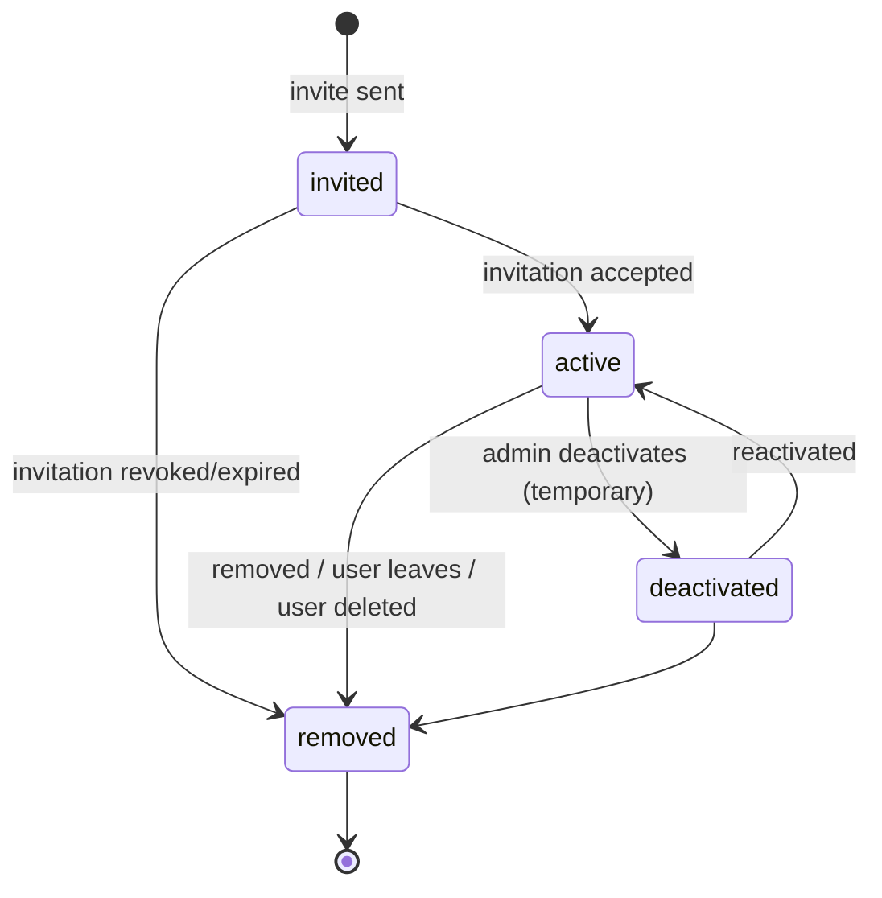

# Memberships and Invitations

| Field | Value |
|---|---|
| Status | Accepted |
| Spec class | Implementation-ready |
| Version | 1.0.0 |
| Last Updated | 2026-09-28 |
| Owner | Organizations domain |
| Blueprint | BP §7, §15.3 ("Removing a membership preserves organizational records"), App. A, App. E |

## Membership States

## Rules

- One membership in `invited|active` per (organization, user) (App. E).
- Invitations: token (hashed), 7-day expiry, initial role assignments and teams; acceptance requires sign-in with the invited email (or verified alias).
- Seat accounting counts `active` memberships excluding guests (provisional) against `seats.max`.
- Removing a membership: sessions lose access to the org immediately (cache bump); authored records remain; open Action Items owned by the member are flagged for reassignment; pending approval requests addressed to the member are reassigned per workflow escalation.
- Last Owner cannot be removed (`ORG_LAST_OWNER`).

## Events and Audit

`organization.member.invited`, `organization.member.joined`, `organization.member.deactivated`, `organization.member.removed`; all audited with actor.
