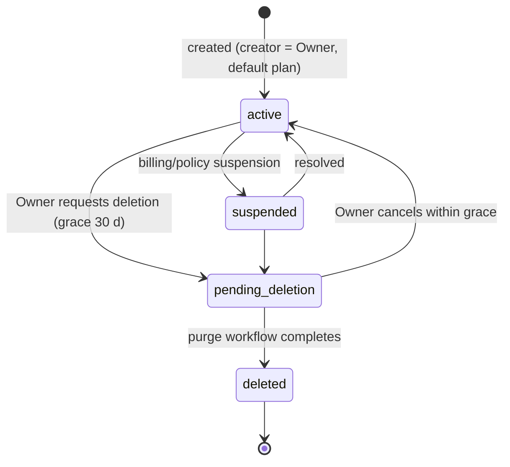

# Organizations

| Field | Value |
|---|---|
| Status | Accepted |
| Spec class | Implementation-ready |
| Version | 1.0.0 |
| Last Updated | 2026-09-28 |
| Owner | Organizations domain |
| Blueprint | BP §2, §7, App. A (Onboarding), App. C (Delete Organization) |

## Model

Organization = tenant. Fields: `slug` (unique), `name`, `kind` (`personal`, `team`), `status`, `locale`, `timezone`, `data_region`, `is_internal`, `settings` (JSONB: default approval behaviour, recording-consent notice text reference, date display calendar).

## Lifecycle

- **Creation (onboarding):** name, locale, timezone, initial policy (App. A). Emits `organization.created`; Commerce subscribes and assigns the default plan (trial or free) — Organizations never call Commerce directly (DR-07).
- **Suspension:** read access continues; new Jobs, uploads and exports are blocked (`ORG_SUSPENDED`).
- **Deletion:** Owner only (`organization.delete`), MFA-verified; export offered first; after grace, the organization deletion workflow purges data by category and writes a final audit summary retained per legal policy ([deletion](../../privacy/deletion.md)).

## Tenant Context

Resolution and propagation: [tenancy-architecture](../../architecture/tenancy-architecture.md).

## Events

`organization.created`, `organization.updated`, `organization.suspended`, `organization.deletion.requested`, `organization.deleted`.
