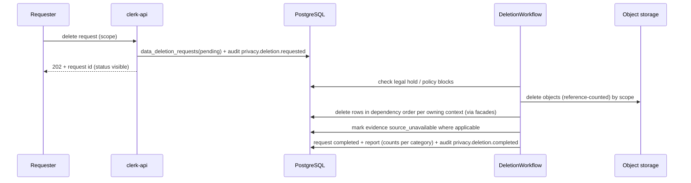

# Deletion

| Field | Value |
|---|---|
| Status | Accepted |
| Spec class | Implementation-ready |
| Version | 1.0.0 |
| Last Updated | 2026-09-28 |
| Owner | Privacy + Tech Lead |
| Blueprint | BP §15.2, §15.3 ("Deletion requests run asynchronously with visible status") |

## Deletion Scopes

| Scope | Initiated by | Effect |
|---|---|---|
| Source | User with `sources.delete` | Objects + extractions + chunks + embeddings deleted; evidence → `source_unavailable` |
| Job | User | Job, runs, knowledge, draft artifacts deleted; final artifacts per policy (may block) |
| Artifact | User with `artifacts.delete` | Versions + exports deleted (final artifacts may be protected by policy/legal hold) |
| Module data | Owner | All jobs/artifacts of a module (after uninstall) |
| User | User (self) | Account PII erased; memberships removed; authored org content remains attributed to "Deleted user" |
| Organization | Owner (MFA) | All tenant data purged after grace period |

## Workflow

Each owning context implements a `DeleteByScope` facade; events `privacy.deletion.requested` fan out to contexts that must clean derived data (search indexes, caches).

## Guarantees

- Visible status (`pending`, `running`, `completed`, `blocked`, `failed`).
- Idempotent and resumable.
- Backups: data persists until backup expiry (disclosed); restores re-apply completed deletion requests ([backup-data-model](../data/backup-data-model.md)).
- Audit events about the deletion are retained (without deleted content).
