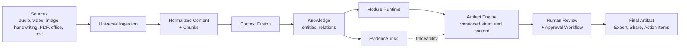

# Product Overview

| Field | Value |
|---|---|
| Status | Accepted |
| Spec class | Baseline |
| Version | 1.0.0 |
| Last Updated | 2026-09-28 |
| Owner | Product |
| Blueprint | BP §0, §1, §2, §3 |

## What Clerk AI Is

Clerk AI is a modular platform that transforms unstructured human input — audio, video, images, handwriting, scans, PDF, DOCX, PPTX, XLSX, plain text and manual notes — into structured, traceable, editable, professional artifacts.

The primary value is **not** "turning a file into text". It is building a verifiable Knowledge layer from multiple Sources and then producing the right Artifact for each use case, in the organization's template, through the organization's review and approval workflow.

## Core Flow

The diagram encodes three decisions: ingestion is module-independent (Source-first), Artifacts derive from Knowledge (Knowledge-first), and Evidence travels with Knowledge into Artifacts (Evidence-first).

## User Experience in One Paragraph

The user opens a **card launcher** of installed modules (or drops Sources into **Quick Clerk**), creates a Job, adds one or more Sources (record, camera, upload, text), and submits. Clerk processes asynchronously with a visible timeline, asks the user to resolve low-confidence items with evidence at hand, produces an editable structured Artifact, routes it through approval if required, and exports PDF/DOCX while turning commitments into trackable Action Items.

## Launch Modules

| Key | Name | Inputs | Outputs | Spec |
|---|---|---|---|---|
| `business.meeting-minutes` | Meeting Minutes | Audio, Video, Image, PDF, Text | Minutes, Decisions, Actions, Risks, Summary | [meeting-minutes](../modules/meeting-minutes/README.md) |
| `construction.site-report` | Construction Site Report | Image, Video, Audio, PDF, Text | Observations, Corrective Actions, Site Report | [site-report](../modules/site-report/README.md) |
| `general.handwriting-document` | Handwriting → Document | Image, Scan, PDF, Text | Clean Document, Letter, Minutes, Task List | [handwriting-document](../modules/handwriting-document/README.md) |
| `education.lecture-summary` | Lecture Summary | Audio, Video, PDF, PPTX, Image, Text | Summary, Concepts, Notes, Questions, Flashcards | [lecture-summary](../modules/lecture-summary/README.md) |

## Expected Outcome of the Foundation Phase (BP §0.1)

1. Multi-tenant core: organizations, users, teams, roles, permissions, entitlements.
2. Real Module Registry and Module Store: install, disable, versioning, configuration.
3. Universal Ingestion for Audio, Video, Image, PDF, DOCX, PPTX, XLSX, Text, Scan.
4. Job Engine and durable workflows (Temporal).
5. Provider-neutral AI Gateway, Prompt Registry, Model Registry, Evaluation Pipeline.
6. Knowledge Layer: Entities, Relations, Evidence, Human Corrections.
7. Artifact Engine: versioning, templates, PDF/DOCX export, approvals.
8. Four launch modules via Card View and Module Launcher.
9. Production-grade Security, Privacy, Audit, Observability, CI/CD, Billing, Usage Metering.

## Related Documents

[product-boundaries](product-boundaries.md) · [personas](personas.md) · [use-cases](use-cases.md) · [v1-scope](v1-scope.md) · [non-goals](non-goals.md) · [product-kpis](product-kpis.md) · [module-catalog](module-catalog.md)
