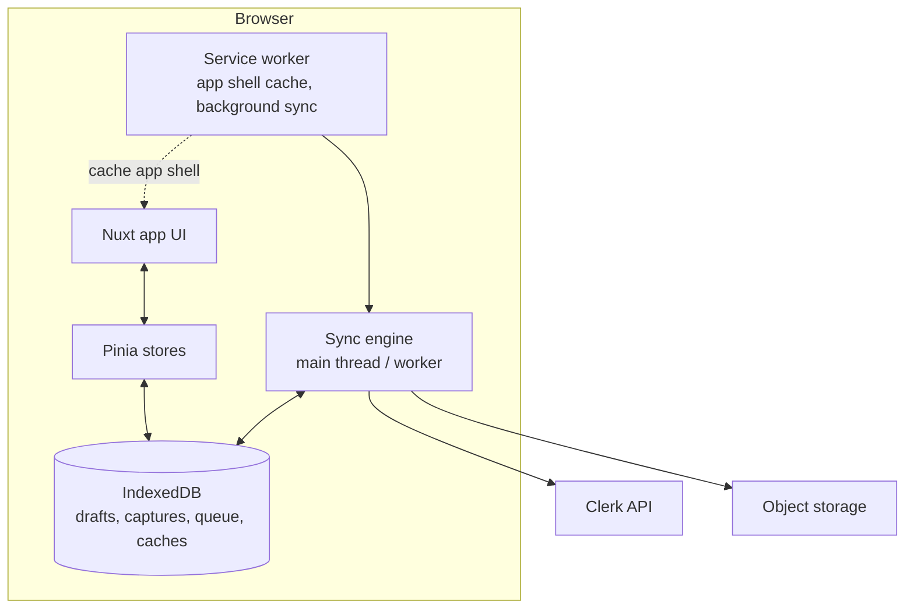

# PWA Architecture

| Field | Value |
|---|---|
| Status | Accepted |
| Spec class | Implementation-ready |
| Version | 1.0.0 |
| Last Updated | 2026-09-28 |
| Owner | Frontend Lead |
| Blueprint | BP §6, §21, [ADR-022](../governance/adr/ADR-022-nuxt-pwa-frontend.md), [PDR-007](../governance/pdr/PDR-007-site-report-mobile-offline.md) |

## Components

## Responsibilities

| Part | Responsibility |
|---|---|
| Service worker | Precache app shell and static assets (versioned), runtime cache for selected GET resources (module cards, project lists, previous visit open items), background sync registration, update flow |
| IndexedDB | Offline drafts, capture blobs, upload queue, idempotency keys, cached read models ([indexeddb-model](indexeddb-model.md)) |
| Sync engine | Creates server objects for local drafts, uploads captures (multipart, resumable), attaches sources, submits jobs, reconciles IDs ([synchronization](synchronization.md)) |
| UI | Clear Local/Pending/Uploading/Synced status (BP §21) |

## Scope in v1

Offline **capture** (Site Report primarily; any slot marked `offline: true`) and offline **read** of cached lists. Offline editing of artifacts, review and approval are online-only (Future: offline editing).

## Platform Constraints

iOS Safari background sync limitations → manual/foreground sync fallback (BP §21 "Background sync where supported, with manual retry fallback"); storage eviction risk mitigated by `navigator.storage.persist()` and user warnings.
