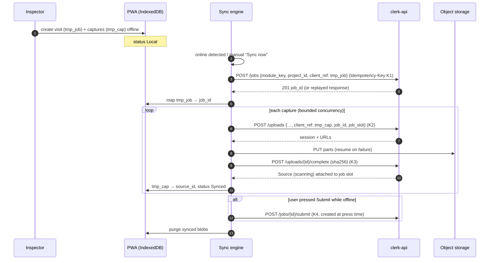

# Synchronization

| Field | Value |
|---|---|
| Status | Accepted |
| Spec class | Implementation-ready |
| Version | 1.0.0 |
| Last Updated | 2026-09-28 |
| Owner | Frontend Lead |
| Blueprint | BP §21 |

## Offline Synchronization Flow

## Rules

- Commands are replayed in dependency order from the IndexedDB outbox; idempotency keys make replays safe across app restarts.
- Server-generated state (job status, artifacts) is pulled after sync; local copies of server entities are caches only.
- Sync runs in foreground with visible progress; background sync where supported ([background-sync](background-sync.md)).
- Session expiry during sync pauses the engine and asks for re-authentication; no data lost.
