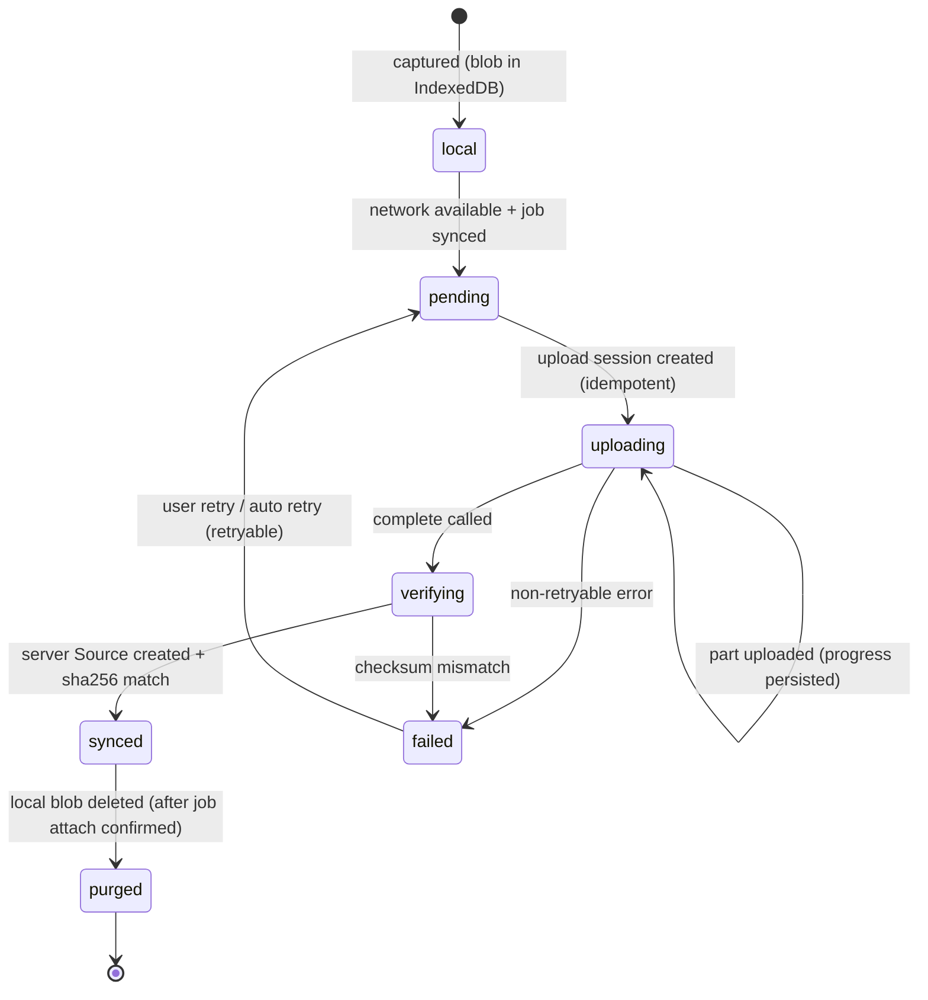

# Upload Queue

| Field | Value |
|---|---|
| Status | Accepted |
| Spec class | Implementation-ready |
| Version | 1.0.0 |
| Last Updated | 2026-09-28 |
| Owner | Frontend Lead |
| Blueprint | BP §21 (upload queues, resumable transfer), §9.1 |

## Capture Status Machine

## Rules

- Concurrency: 2 parallel uploads on cellular, 4 on Wi-Fi (Network Information API where available).
- Retry: exponential backoff (5 s → 5 min), unlimited for transient errors while app open; background sync attempts where supported.
- Resume: completed parts persisted; on resume, `GET /v1/uploads/{id}?refresh_parts=true`; expired session → new session (same idempotency key namespace for the capture, new key for new session).
- Ordering: job draft creation precedes uploads; attaching sources to job slots after each completion (`job_id` + `job_slot` on upload session).
- Integrity: SHA-256 computed on device (Web Crypto, streaming for large files) before upload; server verifies.
- Purge only after `synced` **and** job attachment confirmed.
