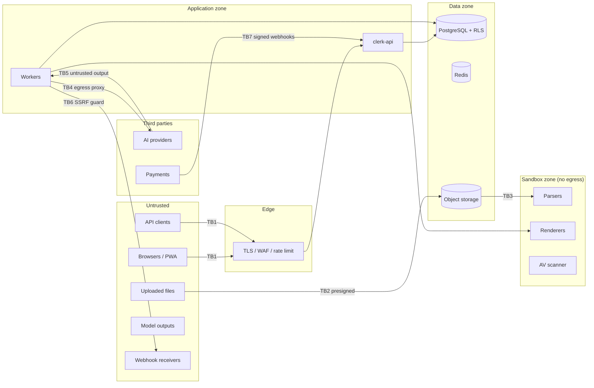

# Security Architecture

| Field | Value |
|---|---|
| Status | Accepted |
| Spec class | Implementation-ready |
| Version | 1.0.0 |
| Last Updated | 2026-09-28 |
| Owner | Security (QA/Security role) + Tech Lead |
| Blueprint | BP §14, §14.1–§14.4, R3–R7 |

## Principle

Security is part of architecture, not a pre-launch checklist (BP §14). Controls align practically with OWASP ASVS, OWASP Top 10:2025, OWASP API Security Top 10 (2023), OWASP Top 10 for LLM/GenAI (2025); an ISMS aligned with ISO/IEC 27001:2022 may follow Enterprise demand. Mentioning a standard does not imply certification.

## Trust Boundaries

| Boundary | Key controls |
|---|---|
| TB1 Client → API | TLS, auth, CSRF, CORS, CSP, rate limits, object-level authz, input validation |
| TB2 Client → storage | Short-lived, key-scoped presigned URLs; staging prefix |
| TB3 Storage → parsers | AV scan first; sandboxed parsers; resource limits |
| TB4 Platform → AI | Data minimisation, tenant AI policy, provider terms, credential isolation |
| TB5 AI → platform | Schema validation, citation checks, sanitisation, human review |
| TB6 Platform → webhooks | SSRF protection, signing, minimal payloads |
| TB7 Payment → API | Signature verification, idempotency |

## Mandatory v1 Controls (BP §14.2)

| Control | Where specified |
|---|---|
| TLS everywhere; encryption at rest DB/object storage; KMS keys in production | [encryption](encryption.md) |
| Argon2id if passwords ever exist; prefer magic link/OIDC | [authentication-security](authentication-security.md) |
| Session rotation, revoke, MFA for Owner/Admin and Enterprise | [authentication-security](authentication-security.md) |
| CSRF, strict CORS, CSP | [api-security](api-security.md) |
| Object-level authorization on every endpoint | [authorization-security](authorization-security.md) |
| Secrets in secret manager; no plaintext keys | [secrets-management](secrets-management.md) |
| Short-lived constrained presigned URLs | [upload-security](upload-security.md) |
| Malware scanning + parser isolation | [malware-protection](malware-protection.md) |
| Layered rate limits + AI budgets | [api-security](api-security.md), [quotas](../billing/quotas.md) |
| Dependency, SAST, secret, container scanning in CI | [dependency-security](dependency-security.md), [vulnerability-management](vulnerability-management.md) |
| SBOM + image signing | [dependency-security](dependency-security.md) |
| Immutable audit for security-sensitive actions | [audit-security](audit-security.md) |

## Documents

[threat-model](threat-model.md) · [security-boundaries](security-boundaries.md) · [tenant-isolation](tenant-isolation.md) · [ai-security](ai-security.md) · [prompt-injection](prompt-injection.md) · [output-validation](output-validation.md) · [module-sandboxing](module-sandboxing.md) · [webhook-security](webhook-security.md) · [security-release-gates](security-release-gates.md)
