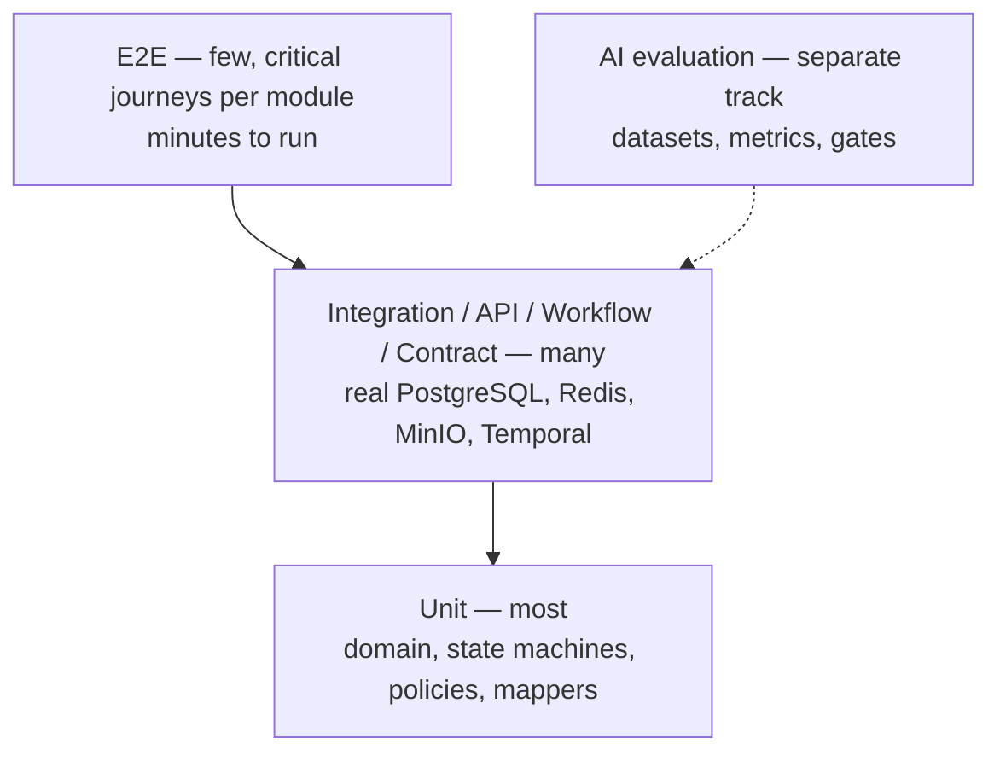

# Test Pyramid

| Field | Value |
|---|---|
| Status | Accepted |
| Spec class | Baseline |
| Version | 1.0.0 |
| Last Updated | 2026-09-28 |
| Owner | Tech Lead |
| Blueprint | BP §19 |

## Targets (guidance, not gates)

| Layer | Share of tests | Runtime budget in CI |
|---|---|---|
| Unit | ~65% | < 3 min |
| Integration/API/Workflow/Contract | ~30% | < 12 min (parallel) |
| E2E | ~5% | < 15 min |
| AI eval smoke | per affected module | < 15 min |

Coverage is monitored for domain packages (target ≥ 80% line coverage for `domain` and authz policy code) but not used as a gate by itself.
